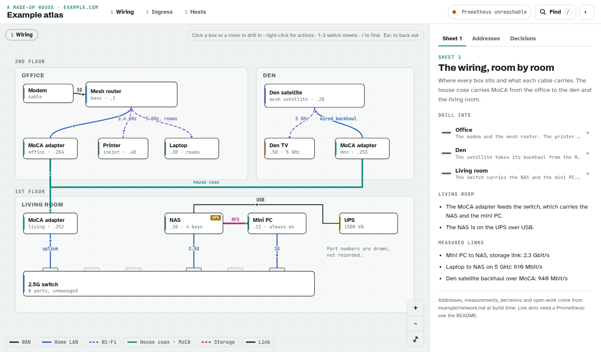
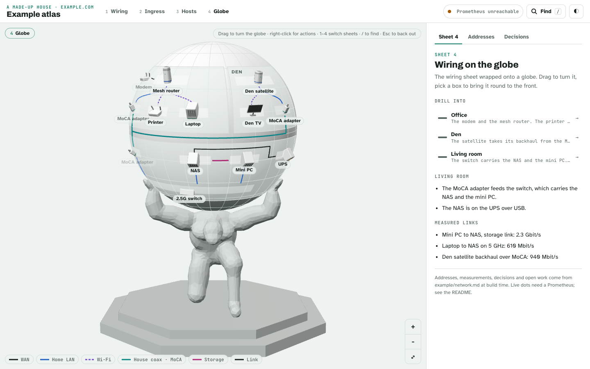

# Atlas

An interactive map of a home network. A house is drawn as a set of sheets (wiring, ingress, hosts, or whatever you need) that share one canvas, so a box drawn on two sheets glides between them when you switch. Click a room or a box to drill in. On a sheet with an origin, picking a box lights its route from there, which is how the ingress sheet traces a hostname from the visitor to the container that serves it.

Live dots come from Prometheus, and from a Netgear Orbi mesh if you have one. Without either, the map still works from the static data.

<picture>
  <source media="(prefers-color-scheme: dark)" srcset="docs/wiring-dark.png">
  
</picture>

The repo ships with a made-up house in `example/`. Your own house goes in `site/`, which git ignores, so the addresses, MACs and hostnames never land in this repo.

## Run it

```bash
bun install
bun run dev      # http://127.0.0.1:7870, localhost only
bun run start    # production build, served at http://127.0.0.1:7871
bun run check    # typecheck, lint, tests, build
```

Keys: `1` to `9` switch sheets, `/` or Cmd-K opens search (names, IPs, MACs, container names), `Esc` backs out one level, `F` fits the drawing back to the view. Every view has its own URL, such as `#/ingress/@s-photos`, and browser back walks the drill history.

Right-click (long-press on a phone, Shift-F10 on a focused box) opens a menu built for what is under the pointer. A box gets copy actions for its IP, MAC, tailnet IP, ssh command and link, its own web UIs, its Grafana and Prometheus pages, and the other sheets that draw it. When something is wrong the fix leads the menu: a host that stopped reporting opens its Grafana page, a failing probe opens its history, a satellite on wireless backhaul jumps to the MoCA adapter on its wired path.

## The globe

The last sheet is the house on a globe, held up by a kneeling titan. It wraps one flat sheet onto the sphere: rooms become curved patches, boxes become small device pieces standing on them, and cables run along the surface. Drag to turn the globe, scroll or pinch to zoom. Picking a box turns it round to the front and lights its route, as on the flat sheet, and the names over the globe are buttons, so Tab walks them and brings a name on the far side round.

<picture>
  <source media="(prefers-color-scheme: dark)" srcset="docs/globe-dark.png">
  
</picture>

It copies the first sheet with rooms on it. Set `globe: { from: "ingress" }` in the site to wrap another, or `globe: false` to leave it out. It takes the next free number key.

three.js loads only when the globe sheet opens. A browser without WebGL gets a note instead, and the flat sheets keep working.

The titan and the device pieces were modelled for this repo in Blender, from the scripts in `models/recipes/`, and live in `src/assets/models/` as GLB files. No outside models are used. Each piece is named by its `kind`, and its materials are named by role (`body`, `trim`, `accent`, `led`, `screen`) so the globe repaints them from the theme. The `led` takes the box's live state. A kind with no piece falls back to a plain block. To rebuild one, run its recipe as a Blender script job; it writes the GLB to `OUT_DIR`.

## Your own house

Start from the example:

```bash
cp -r example site
```

Or keep the data somewhere else, such as a private repo, and link it in:

```bash
# with the site folder at ../my-house, next to this checkout
ln -s ../my-house site
echo '{ "extends": "../atlas/tsconfig.json" }' > ../my-house/tsconfig.json
```

The second line matters for a symlink. Vite, tsc and bun resolve the site's files at their real path, so the folder needs a tsconfig that points `@/` back at this checkout. The `extends` path runs from the site folder to the checkout.

`@site` resolves to `site/index.ts` when it exists and to `example/index.ts` otherwise. `vite.config.ts` and `tsconfig.json` agree on that order. Tests under `site/test/` run with the rest; the example's own tests skip when a site is linked in, and the checks in `test/site.test.ts` (every wire end is a box, every view survives the URL, every box has a menu) run against whichever site is there.

A site folder holds:

| File | What it is |
| --- | --- |
| `index.ts` | Exports `site: Site` (see `src/data/types.ts`): title, entities, lenses, the parsed network doc, and optional Grafana and Prometheus links. |
| `entities.ts`, `lenses.ts` | The boxes and the sheets, by convention. `@/lib/layout` has `box`, `grid`, `ring` and `fan` for laying them out; `@/lib/entities` has `indexEntities`, which joins MACs in from the network doc, and `addGroupBoxes`, which turns a host's container groups into boxes. |
| `network.md` | The address table, measurements, decisions and open work. Any markdown file works; `index.ts` imports it with `?raw`. |
| `server.json` | Optional. What the dev and preview servers need, below. |

### The network doc

The atlas reads four sections and ignores the rest of the file:

```markdown
## Addresses

| Address | Device | MAC | How it's held |
| --- | --- | --- | --- |
| 192.168.50.10 | NAS | 02:00:00:00:00:10 | reservation |

## Measured

| Path | Result |
| --- | --- |
| Mini PC to NAS | 2.3 Gbit/s |

## Decided

- **The NAS keeps the media.** Anything whose working set is the array stays on it.

## Open work

- [ ] Put the mini PC on the UPS.
```

A box with an `ip` takes its MAC and "how it's held" from the matching row, so they are written down once.

### server.json

```json
{
  "prometheus": "http://127.0.0.1:9090",
  "orbi": "../scripts/orbi",
  "allowedHosts": [".ts.net", "atlas.example.com"],
  "fsAllow": ["../docs/home-network.md"]
}
```

Paths are relative to the site folder after following any symlink.

- `prometheus` is the target of the `/prom` proxy. `ATLAS_PROM` overrides it.
- `orbi` is a command for the `/orbi` feed. `ATLAS_ORBI` overrides it.
- `allowedHosts` lists the Host headers the preview server accepts besides localhost, for `tailscale serve` or a tunnel.
- `fsAllow` lists files outside the site folder that it imports, so the dev server may read them.

## Live data

Both servers proxy `/prom` to Prometheus, and pass only `/api/v1/query` and `/api/v1/query_range`. If you publish the atlas, the rest of Prometheus's API stays off the internet. The atlas polls every 15 s. An entity's `live` key says how to find it:

| Key | Reads |
| --- | --- |
| `host` | node_exporter's `host` label: up, CPU, memory, load, uptime, and an hour of CPU and memory in the panel |
| `cadvisor` | the instance IP whose `container_last_seen` series are counted |
| `probe` | a blackbox `instance`: `probe_success` and `probe_duration_seconds` |
| `job` | a scrape job: how many of its `up` targets answer |
| `speedtest` | `speedtest_download_bits_per_second`, `_upload_`, `_latency_seconds`, `_last_success_timestamp_seconds` |
| `sleeps` | with `probe`: a failed probe draws the box powered off, not red. `lan_device_ipp_state`, `lan_device_escl_state` and `lan_device_display` (by `target` IP) add what a printer or scanner reports. |

The `/orbi` feed runs the site's `orbi` command as a bash script, at most once a minute. `orbi devices full` must print a JSON array of attached devices (`mac`, `ip`, `name`, `type` as the band or `wired`, `signal`, `conn_ap_mac`), and `orbi satellites` a JSON array of satellites (`MAC`, `DeviceName`, `BHConnType`). With that, the router and satellites show client counts, a satellite turns red when its backhaul is not wired, every box the Orbi sees says which unit it is on, and a lens's `roams` table moves Wi-Fi boxes to the unit they joined.

## Publishing it

The atlas has no login. Keep the dev server on localhost and put the production build behind something that does auth: `tailscale serve`, Cloudflare Access, or a reverse proxy with forward-auth. Add the hostname to `allowedHosts`.

## Layout

```
src/        the app (React, motion, one SVG canvas, three.js for the globe)
models/     the Blender scripts that build the titan and the device pieces
server/     the /orbi feed and the site lookup the servers share
example/    the made-up house, its network doc and its tests
test/       parser tests and checks that hold for any site
site/       your house (gitignored)
```

## License

MIT. See [LICENSE](LICENSE).
